# Company Store

A SharePoint web part: an internal shop where staff browse company merchandise and
place orders, run entirely from SharePoint lists. No server and no payment handling.
Prices are optional, and an item priced at 0 shows as Free.

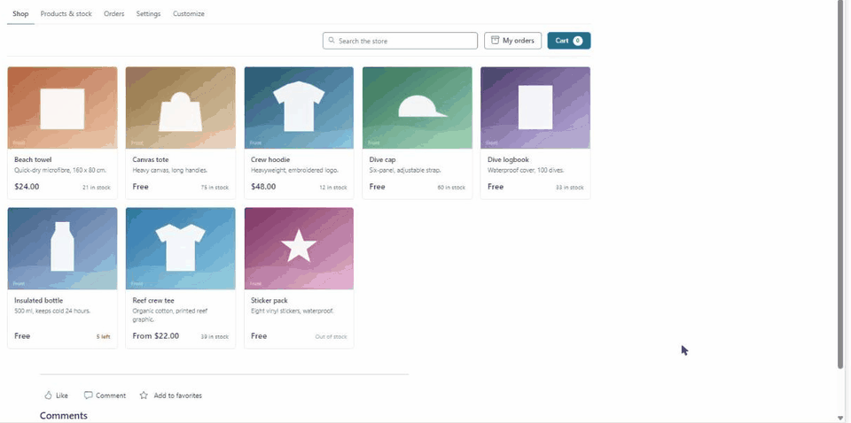

For a tour of the features, see the [Company Store page](https://thomasdaly.net/projects/company-store/).

## Contents

- [What you need](#what-you-need)
- [Install](#install)
- [Before going live: email](#before-going-live-email)
- [The lists it creates](#the-lists-it-creates)
- [Using the shop](#using-the-shop)
- [Running the store](#running-the-store)
- [Good to know](#good-to-know)
- [Development](#development)

## What you need

| Who | What they do |
|---|---|
| SharePoint Administrator | Uploads the package to the tenant app catalog and enables it. |
| Global Administrator | Approves the store's request to send email (Microsoft Graph, `Mail.Send`). |
| Site owner | Adds the app and web part to a page, then runs setup. |
| Site collection administrator | Only needed to change the address list after setup, or when the store asks for IT. |

One person can do all of these if they hold those roles. The site must be one that all
staff can open.

## Install

1. Download `react-company-store.sppkg` from the
   [latest release](https://github.com/tom-daly/spfx-company-store/releases/latest).
2. In the **SharePoint admin center**, go to **More features → Apps → Open**, then
   **Upload** the file.
3. In the panel that opens, choose whether to tick **Enable this app and add it to all
   sites**, then click **Enable app**. If you leave it unticked, site owners add it from
   **New → App** on their own site, under **From Your Organization**.
4. On a site all staff can open, edit a page and add the **Company store** web part,
   which is in the web part picker's **Advanced** group. Publish the page.
5. As a site owner, open the page and click **Set up the store**. It makes the lists and
   a **Store managers** group, and sets who can see what. It takes about half a minute.
6. Go to **Products & stock** to add your products, or click **Add sample products** to
   see how the store looks. The samples can be deleted later.
7. Go to **Settings** and fill in **Who gets order emails**.

Setup is safe to run again. When something is missing or has been changed by hand, site
owners see a **Fix it** button on the page. Once the address list is locked, only a site
collection administrator can change it.

### Updating to a new release

Upload the new `.sppkg` over the old one in the app catalog and enable it again. Your
lists, products and orders aren't touched. If the new version needs a change to the
lists, site owners see **Fix it** on the page.

### Removing it

Removing the web part never deletes the lists or the orders in them.

## Before going live: email

The store sends these emails, each from the mailbox of the person who caused it:

| Email | Goes to | Sent from |
|---|---|---|
| New order | The people in **Who gets order emails**, with the buyer copied in | The buyer |
| Order confirmed, Ready for pick-up, On its way | The buyer | Whoever moved the order along |

For that to work, the store's permission request has to be approved once:

1. Upload the package to the app catalog (see [Install](#install)).
2. A **Global Administrator** opens the **SharePoint admin center → Advanced → API
   access**.
3. They approve the pending request for **Microsoft Graph · Mail.Send**.

Microsoft requires a Global Administrator to approve Microsoft Graph permissions; a
SharePoint Administrator alone isn't enough
([Microsoft's guide](https://learn.microsoft.com/en-us/sharepoint/api-access)).

**Check with IT first.** This permission isn't limited to the store. Once approved, any
SharePoint add-on in the organization can send email as the person using it. It can't
send as anyone else, and it stays approved even if the store is removed, so someone has
to revoke it on the same page if you no longer want it.

Until it's approved, orders still save as normal, but no email goes out and the order
shows **Email sent: No**.

## The lists it creates

| List | Web address | Who sees what |
|---|---|---|
| Store settings | `Lists/CompanyStoreSettings` | Currency, order numbers, pick-up and delivery. Site owners and store managers change them from the store page. Hidden. |
| Store products | `Lists/CompanyStoreProducts` | Staff read; site owners and store managers edit. |
| Store stock | `Lists/CompanyStoreStock` | Staff can change the numbers so checkout can take items off. Hidden. |
| Store orders | `Lists/CompanyStoreOrders` | One row per order. Staff see only their own; site owners and store managers see all. |
| Store addresses | `Lists/CompanyStoreAddresses` | Each person sees only their own row. Site owners and store managers are taken off it; only site collection administrators can get in. Hidden, kept out of search, no version history. |

The list definitions are in `src/webparts/companyStore/setup/schema.ts`.

## Using the shop

**Browsing.** Staff see a grid of active products, each with its price and how many are
left. Ten or fewer shows as "5 left". Search covers names, descriptions and each
product's search words.

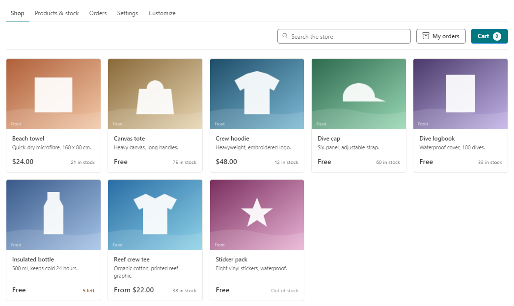

**Choosing.** On a product page, people pick from its options. A choice with nothing left
is crossed out, and that changes with what else is picked. Colours with their own photos
switch the big picture.

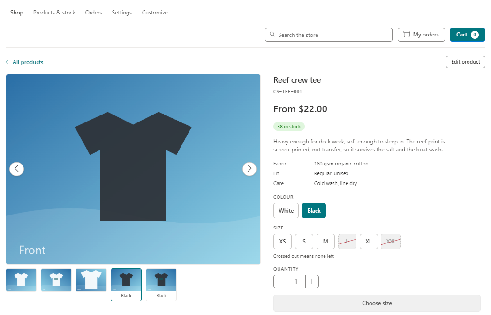

**Cart.** Adding something opens the cart. Quantities can't go above what's in stock. If
stock runs out while something is in the cart, the cart updates and says so.

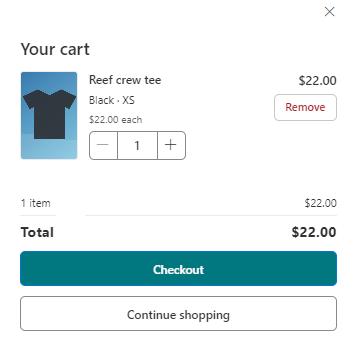

**Checkout.** People pick **pick up at the office** or **delivery**, whichever you've
turned on. Delivery asks for an address, which can be remembered for next time and
forgotten again with **Forget my saved address**. Anyone can add a note for the store
team. Stock comes off when the order is placed.

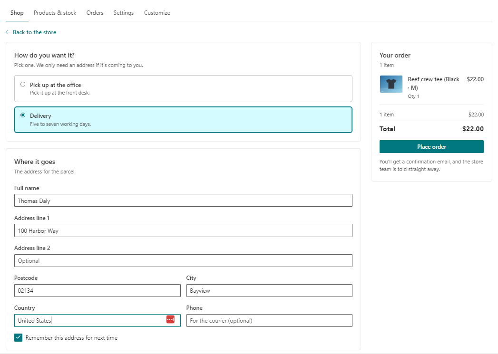

**After ordering.** The buyer sees their order number and what happens next.

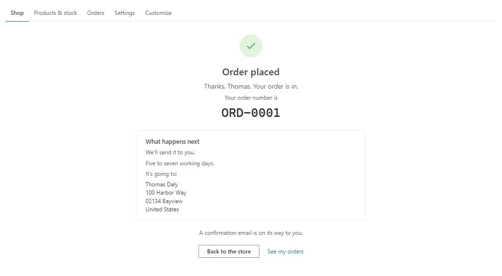

**My orders.** Everyone can see their own orders, newest first, with a progress bar and
any tracking link.

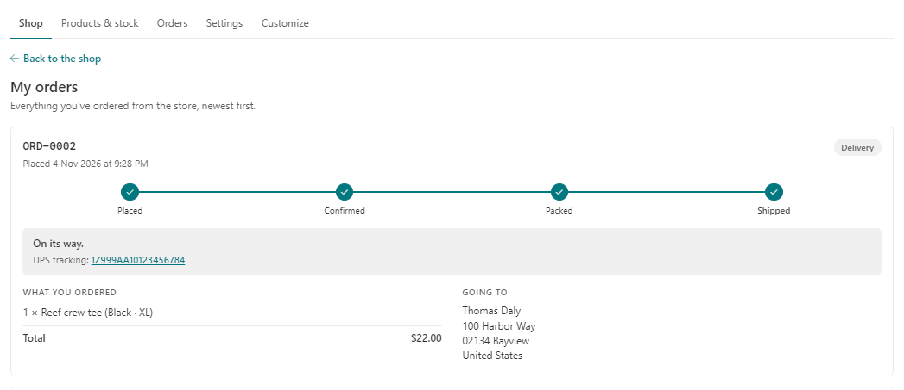

## Running the store

Site owners and store managers see extra tabs along the top of the store. Site owners add
and remove store managers on the **Settings** tab.

### Products & stock

The table lists every product, with filters for **Running low**, **Out of stock** and
**Off**. Turning a product off hides it from the shop without deleting it. **Delete** asks
you to confirm, on the button itself.

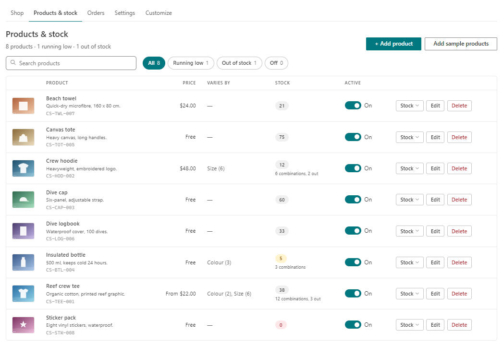

**Add product** or **Edit** opens the editor:

- **Short description** shows on the product card, and **Full description** on its page.
- **Details** is one per line, like `Fabric: organic cotton`.
- **Search words** are extra words people might search for, separated by commas.
- **Photos**: the first is the cover. Store managers can add photos too.

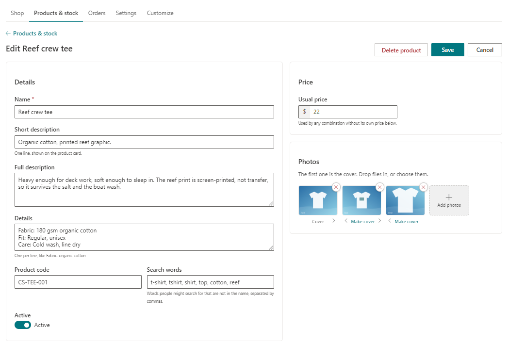

### Variations

Under **What it varies by**, add up to three options, like Colour, Size and Fit, with up to
100 combinations in total. Type several choices at once with commas between them. Click
the square beside a choice to give that choice its own photos. Leave this section empty
for something that comes one way only.

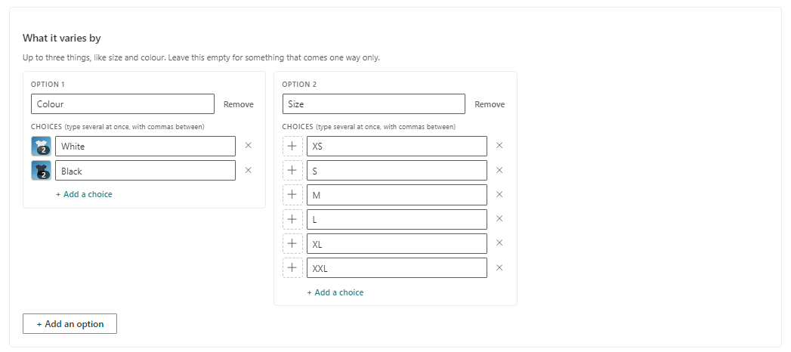

**Stock and prices** then shows a box for each combination. **Fill** puts the same number
in every box. Tick **Some combinations cost more or less than the usual price** to give a
combination its own price; empty boxes use the usual price. You can also change stock
straight from the table with the **Stock** button.

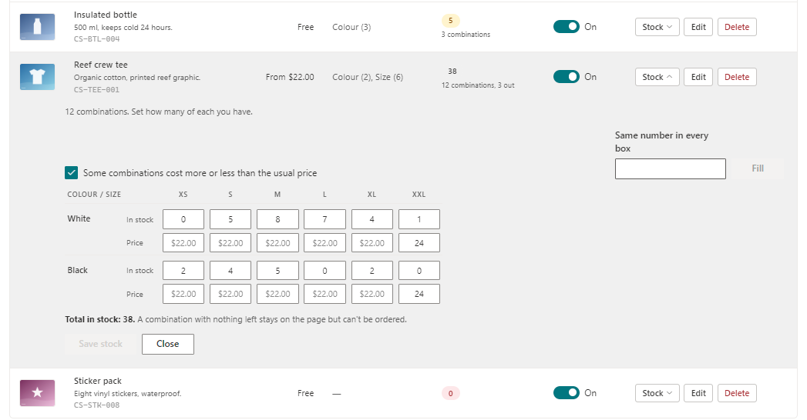

### Orders

Filter by **Open**, **New**, **Confirmed**, **Packed**, **Ready for pick-up**, **Done** or
**All**, and search by order number, name or item. Open a row to see the address, buyer,
items, note and history.

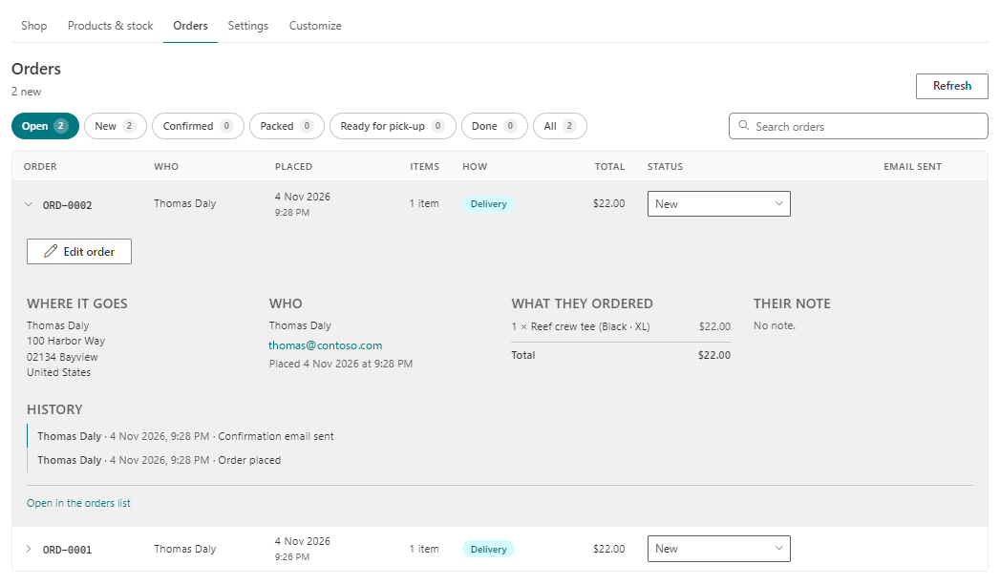

Changing the status in the table asks whether to email the buyer. Marking an order shipped
also asks for a tracking number.

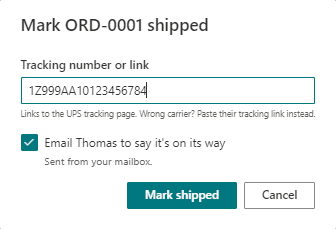

Tracking numbers from USPS, UPS, FedEx, DHL and OnTrac become a link to that carrier's
page. For other carriers, paste the full tracking link instead.

**Edit order** changes the status, dates, tracking, quantities, delivery method, address
and note. Changing a quantity puts stock back or takes it to match. Setting a quantity to 0
takes the item off the order. Saving here doesn't email anyone; to let the buyer know,
change the status in the table.

### Settings

- **Currency**: US dollar, euro or British pound. Choose this before adding products.
- **Order numbers start with**: up to 10 letters, numbers or dashes.
- **Who gets order emails**: one or more addresses, separated by commas. A shared mailbox
  works too.
- **How people get their order**: turn pick-up and delivery on or off.
- **Store managers**: the people who run the store day to day.

### Customize

**Customize** shows the checkout, order-placed screen and emails as staff will see them,
with a made-up order. Click any outlined words to change them. Fill-ins like
`{first name}`, `{name}`, `{order}` and `{total}` are swapped for the real details.

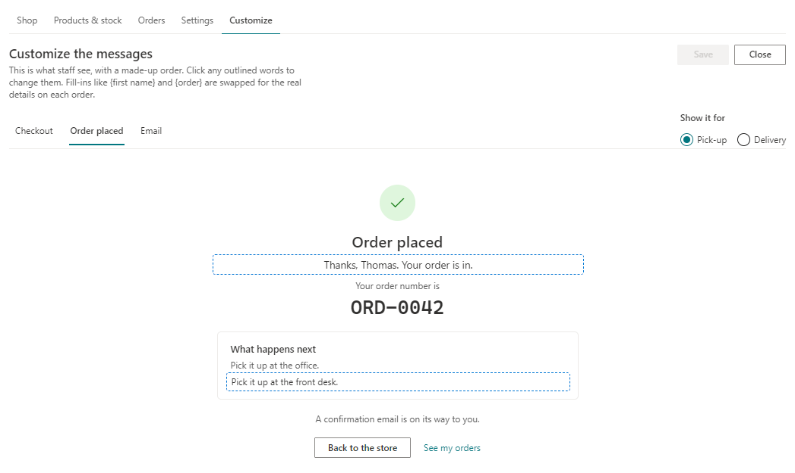

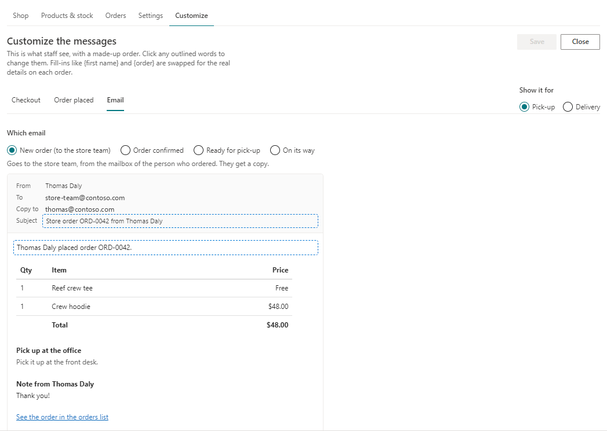

## Good to know

- The store doesn't take payment. Prices are for information, so collect any money your
  own way.
- Guests aren't included. Setup lets in everyone in the organization, leaving guests out.
- The address list is locked on purpose. After setup, only a site collection administrator
  can open it.
- Order emails need the permission above. Without it, the order still saves.

## Development

Node 22.14.0, as set in `.nvmrc`. `build.cmd` does the whole build in one go. Or run
`npm install`, then:

- `npm run build`: build, lint, test and package (`sharepoint/solution/*.sppkg`).
- `npm start`: serve locally for the hosted workbench.
- `npx heft test`: run the tests.

SharePoint calls go through [PnPjs](https://pnp.github.io/pnpjs/).

### Publishing a release

Push a version tag and GitHub builds, tests and publishes the release, with the `.sppkg`
attached:

```bash
git tag v1.0.0
git push origin v1.0.0
```

The tag sets the package's version, so use a higher number each time. SharePoint uses it
to tell that the package has been updated.

## Licence

[MIT](LICENSE) © TMD Consulting LLC.
